# RobotLang Compiler Architecture

## Pipeline Overview

```mermaid
flowchart LR
    Src["Source (.rbt)"] --> Lex["Lexer\n(lexer.py)"]
    Lex -->|Tokens + Pos| Parse["Recursive-Descent Parser\n(parser.py)"]
    Parse -->|AST| Sem["Semantic Analyzer\n(semantic.py)"]
    Sem -->|Checked AST + Arena/Scope Validation| IR["IR Generator\n(ir.py)"]
    IR -->|Structured IR| Unroll["Loop Expander\n(unroll_ir)"]
    Unroll -->|Flat IR| Opt["Peephole Optimizer\n(optimizer.py)"]
    Opt -->|Optimized Flat IR| CG["Code Generator\n(codegen.py)"]
    CG -->|PIC16F877A Assembly| Sim["PIC16 Simulator + Plotter\n(simulator.py)"]
```

## Stage Responsibilities

1. **Lexer (`robotlang/lexer.py`)**: Hand-written character cursor tracking 1-based `line` and `col` on every token, stripping `#` comments, and recovering from unexpected characters.
2. **Parser (`robotlang/parser.py`)**: Predictive LL(1) recursive-descent parser building immutable `@dataclass` AST nodes (`robotlang/ast_nodes.py`). Uses panic-mode recovery (synchronizing at `;`, `}`, or statement starters) to report multiple syntax errors in a single pass.
3. **Semantic Analyzer (`robotlang/semantic.py`)**:
   - Domain validation: `Move` distance >= 0, `Turn` angle in `[0, 360]`, `REPEAT` count positive integer, division-by-zero checks.
   - Scoped `SymbolTable` for variables (`SET`) and procedure parameters (`DEF`/`CALL`).
   - Runaway loop / recursion guard (`max_steps = 10,000`, `max_call_depth = 64`).
   - Domain-specific **arena boundary check** (`[-50, 50] x [-50, 50]` by default).
   - Non-fatal warnings for empty `REPEAT` and `IF` blocks.
4. **IR Generator (`robotlang/ir.py`)**:
   - Structured IR preserves static loops with `LOOP_BEGIN n` / `LOOP_END`.
   - `unroll_ir` expands loops into a flat linear instruction stream (`MOVE`, `TURN`).
5. **Optimizer (`robotlang/optimizer.py`)**: Fixed-point peephole pass merging consecutive same-direction moves, merging consecutive turns, and removing `MOVE 0` and `TURN 360`/`0` no-ops, reporting before/after counts.
6. **Codegen & Simulator (`robotlang/codegen.py`, `robotlang/simulator.py`)**: Emits Microchip PIC16F877A (`pic-as`) assembly with `PORTB` initialization, chunked 8-bit `MOVLW`/`CALL` motor commands (`MOVE_FWD`, `MOVE_BWD`, `TURN_RIGHT`, `TURN_LEFT`), and delay subroutines; interprets those `MOVLW`/`CALL` instructions in the simulator (`x += d * sin(heading)`, `y += d * cos(heading)`), records an execution trace table, and plots via `matplotlib` (interactive window or PNG/SVG export).

## Viva Quick Reference

- **Why recursive descent rather than a parser generator?** Full control over error messages, panic-mode synchronization, zero external grammar-build toolchain, and direct 1-to-1 mapping from EBNF rules to Python methods.
- **Syntax error vs. semantic error?** Syntax errors violate token ordering/grammar (`FORWARD 5` missing `;`, unmatched `}`), while semantic errors are grammatically valid but violate meaning or domain constraints (`FORWARD -5;`, `REPEAT 2.5`, undefined variables, leaving the arena).
- **Why an IR instead of generating output directly from the AST?** Decouples front-end language constructs (`REPEAT`, `SET`, `DEF`, `IF`) from target output, makes loop expansion explicit, and enables simple peephole optimizations on a uniform flat instruction list.
- **How do you stop infinite or huge loops?** By validating `REPEAT` counts as positive integers and enforcing a strict expansion cap (`max_steps = 10,000`) plus a procedure call-depth cap (`64`).

